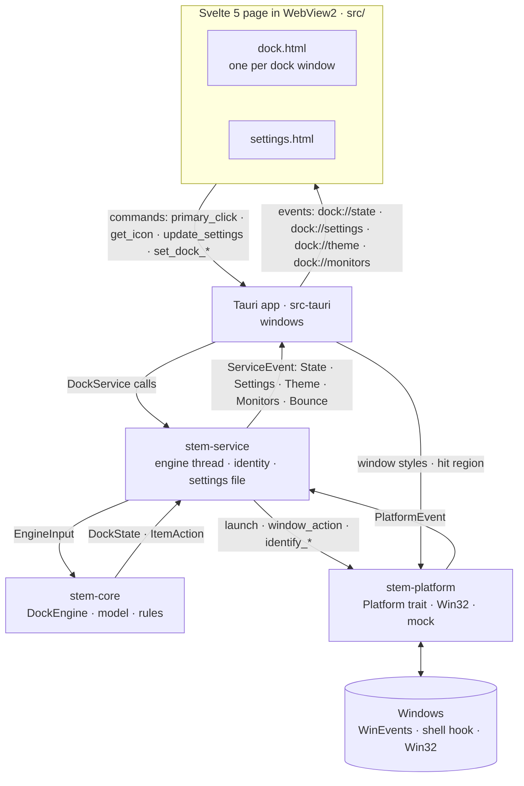

<div align="center">


# Stem

**A floating dock for Windows 11.**

A rounded panel at the bottom of the screen shows your pinned and running apps. Icons grow as the
pointer passes over them, and an indicator marks each running app. Stem is written in Rust with
Tauri 2 and Svelte 5.

[](LICENSE)

    

[What is Stem?](#what-is-stem) ·
[How it works](#how-it-works) · [Build from source](#build-from-source) ·
[Development](#development) · [Documentation](#documentation) · [License](#license)

</div>

## What is Stem?

Stem is a dock for Windows 11. It is a floating, centred, rounded panel on the bottom edge of the
screen. It shows Start, your pinned apps, the other running apps and the Recycle Bin. Stem can hide
the stock taskbar while it runs, or work beside it.

Stem is in early development: milestone M0 is done and M1 is in progress
([docs/PLAN.md](docs/PLAN.md)). Nothing is released yet.

## How it works



Rust decides and the page renders. `stem-core` holds the pure model and the rules: what a click
does, and how items are ordered and grouped. It never calls the OS. `stem-platform` is the only
code that calls Win32 and the only place with `unsafe` code, and its mock implements the same
`Platform` trait on any host. `stem-service` runs the engine on its own thread, passes it the
platform's events, resolves app names and icons, and saves the settings file. The Tauri app in
`src-tauri` creates the windows and passes commands and events between the service and the Svelte
page. The page draws the `DockState` snapshot it receives and reports what the user did.
[docs/architecture/](docs/architecture/index.md) describes every part, and
[docs/ipc/](docs/ipc/index.md) lists every command and event.

## Build from source

You need Windows 11 with:

- Rust through `rustup`, on the `stable` channel that [`rust-toolchain.toml`](rust-toolchain.toml)
  names.
- Node.js 22 and pnpm.
- The Tauri prerequisites for Windows: the Microsoft C++ Build Tools and the WebView2 runtime.

Then:

```bat
pnpm install
cargo tauri dev
```

## Development

Read [AGENTS.md](AGENTS.md) first: it holds the rules for every change, by people and agents alike.
Most of the code (everything except the final binary) can be developed and tested on Linux:
`stem-core`, the mock platform and `stem-service` run their tests there, a lint for the
`x86_64-pc-windows-msvc` target type-checks the Windows code, and the page runs in a browser against
`MockBackend`.

| Command | What it does |
| ------- | ------------ |
| `pnpm dev` | Serves the dock page alone, against the mock backend, in any browser |
| `scripts/check-all.sh` | The verification ladder on Linux or macOS: formatting, lints, tests, the generated TypeScript bindings, the Windows-target lint, frontend checks and the Playwright suite |
| `pnpm e2e:screenshots` | The Playwright suite in mock mode: screenshots in `e2e/output/` |

## Documentation

| Where | What |
| ----- | ---- |
| [docs/architecture/](docs/architecture/index.md) | Layers, data flow, threads, app identity, icons, the dock window, settings, error handling, performance budgets and security |
| [docs/ipc/](docs/ipc/index.md) | The contract between Rust and the page: every command and event |
| [docs/PLAN.md](docs/PLAN.md) | The milestones and the non-goals |
| [docs/adr/](docs/adr/) | The architecture decisions, one record each |
| [AGENTS.md](AGENTS.md) and [docs/development/](docs/development/index.md) | The rules every change in this repository follows, and the detail behind them |

## License

Stem is licensed under the [GNU Affero General Public License v3.0](LICENSE).
