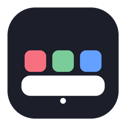
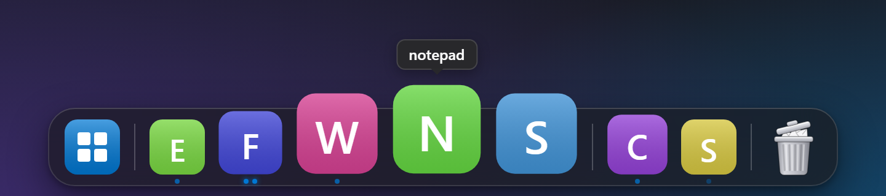
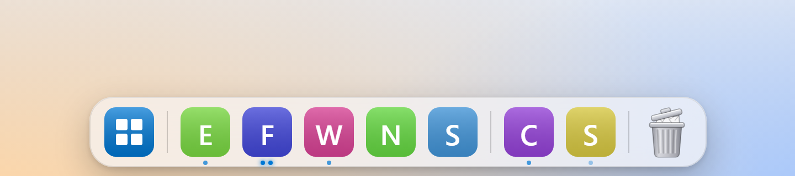
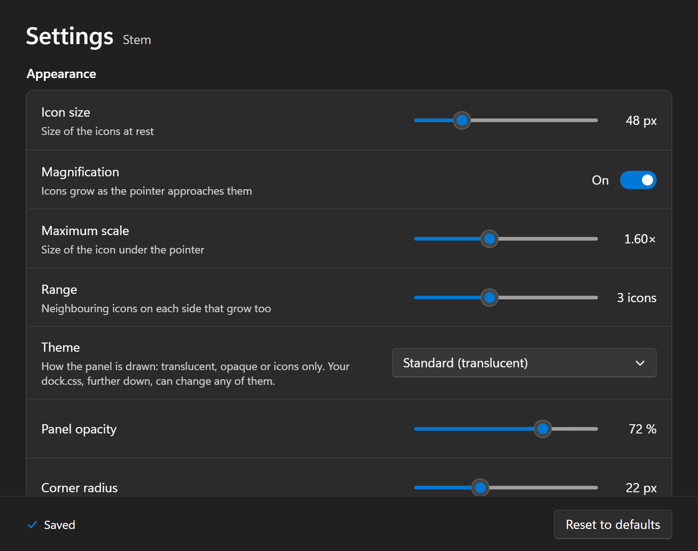
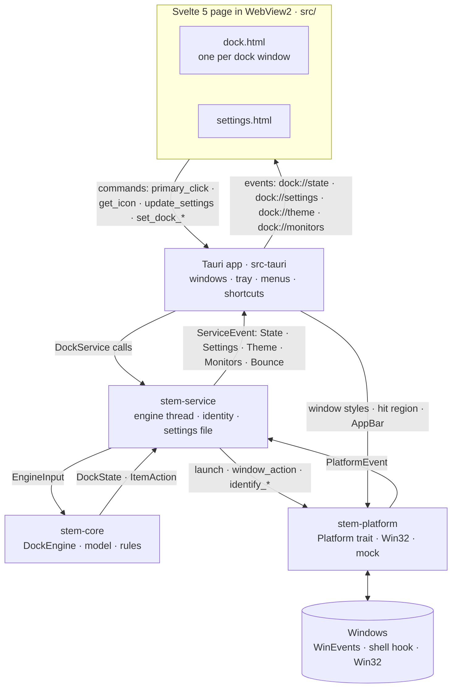

<div align="center">



# Stem

**A floating dock for Windows 11.**

A rounded panel at the bottom of the screen shows your pinned and running apps, one icon per app.
Icons grow as the pointer passes over them, dots mark running apps, and an icon bounces while its
app starts. Stem is written in Rust with Tauri 2 and Svelte 5.



[](LICENSE)

    

Magnification · running dots · drag to pin · auto-hide · multi-monitor · theme sync

[What is Stem?](#what-is-stem) · [Features](#features) · [In action](#in-action) ·
[How it works](#how-it-works) · [Install](#install) · [Build from source](#build-from-source) ·
[Development](#development) · [Documentation](#documentation) · [License](#license)

</div>

## What is Stem?

Stem is a dock for Windows 11. It is a floating, centred, rounded panel on the bottom edge of the
screen. It shows Start, your pinned apps, the other running apps and the Recycle Bin, and the
windows of one app share one icon. Stem can hide the stock taskbar while it runs, or work beside it.

Stem runs on Windows 11 only. Windows 10, macOS and Linux are not supported. It does not replace
the notification area: the tray icons and the input indicators stay on the stock taskbar.

## Features

**Apps.** Pinned and running apps share the dock, grouped per app: a pinned app and its windows are
one icon, with the app's real name and icon. Packaged (Store) apps are recognised as well as classic
ones. Drag a pinned icon to reorder it, or drop an `.exe` or a shortcut from File Explorer onto the
dock to pin it.

**Clicks and menus.** A click starts an app, brings its window to the front, minimises it or cycles
through its windows. Whether a click on the app in front minimises it is a setting. A right-click
opens a native Windows menu: the app's windows, _New window_, _Pin to Stem_ or _Unpin from Stem_,
_Close all windows_, settings and quit.

**Look.** Icons grow near the pointer, tooltips name the app, and an icon bounces while its app
starts. Up to three dots per app show its open windows, dimmed while all of them are minimised. An
app that asks for attention gets an orange pill in place of its dots and wiggles until you switch
to it. The dock follows the Windows accent colour, light and dark mode, transparency effects and
contrast themes, with a light or dark override. The settings window offers one backdrop, which the
page draws itself (`css`, named _Blur (built in)_). The Acrylic and Mica backdrops are not
available.

**Fixed items.** Start and the Recycle Bin are on by default. Task View and Show Desktop items can
be turned on. The Recycle Bin item shows whether the bin is full, opens or empties it, and moves
files dropped on it to the bin.

**Auto-hide and fullscreen.** The dock can hide always, or only while a window overlaps it. Move
the pointer to the bottom edge under the dock to bring it back. Fullscreen apps (games, videos,
presentations) hide the dock of their monitor. By default, clicks outside the panel go to the
desktop and the windows behind it.

**Edges and monitors.** The dock sits on the bottom edge. While auto-hide is
off, it can reserve its band of the screen, as the stock taskbar does, so maximised windows stop
short of it. You can have one dock per monitor, following monitors as they are plugged in and out,
with an option to list only each monitor's windows on its dock. A change of display scale applies
without a restart. By default the dock lists only the windows on the current virtual desktop.

**Taskbar, keyboard and tray.** Stem can hide the stock taskbar while it runs, and puts it back on
quit. It can start when you sign in. By default, `Ctrl+Alt+D` shows or hides the dock from any app.
Keyboard navigation of the dock is incomplete. A left click on the tray icon shows or hides the
dock, and the tray menu opens the settings, restarts Stem or quits it. Starting Stem again shows the
running dock. After a crash, the next start says so once and offers to open the log folder.

**Settings.** The settings window applies every change at once. It lists the pinned apps, has
_Reset to defaults_, and ends with an About section that shows the version and the paths of the
settings and log files and opens their folders.

Every setting is described in the [user guide](docs/user-guide/index.md), and every key of the
settings file, with its type, range and default, in the [settings reference](docs/SETTINGS.md).

## In action

The captures below, like the one at the top, are mock-mode renders from the project's Playwright
suite: demo apps with placeholder letter icons, not a real desktop. The one at the top shows the
dark theme with the pointer over Notepad: the icons near it grow and a tooltip names the app.

<table>
<tr><td align="center" valign="top">

<br><sub>The light theme at rest: Start, the pinned apps, the other running apps and the Recycle Bin.</sub>
</td></tr>
<tr><td align="center" valign="top">

<br><sub>The settings window, where every change applies at once.</sub>
</td></tr>
</table>

## How it works



Rust decides and the page renders. `stem-core` holds the pure model and the rules: what a click
does, and how items are ordered and grouped. It never calls the OS. `stem-platform` is the only
code that calls Win32 and the only place with `unsafe` code, and its mock implements the same
`Platform` trait on any host. `stem-service` runs the engine on its own thread, passes it the
platform's events, resolves app names and icons, and saves the settings file. The Tauri app in
`src-tauri` creates the windows, the tray and the menus, and passes commands and events between the
service and the Svelte page. The page draws the `DockState` snapshot it receives and reports what
the user did. [docs/architecture/](docs/architecture/index.md) describes every part, and
[docs/ipc/](docs/ipc/index.md) lists every command and event.

## Install

Every run of the _CI_ workflow on GitHub builds the installer. A pushed `v<version>` tag also builds
it and attaches it to a draft GitHub release, which is published by hand
([docs/RELEASING.md](docs/RELEASING.md)). To take the installer from CI:

1. Open the repository's _Actions_ tab, then the _CI_ workflow, and pick the latest run on
   `master` with a green tick.
2. Download the `stem-installer` artifact (GitHub asks you to sign in for artifacts) and unzip it.
3. Run the `Stem_<version>_x64-setup.exe` inside, such as `Stem_0.1.0_x64-setup.exe`.

Neither the installer nor `stem.exe` is code-signed, so SmartScreen may stop the installer: choose
_More info_ → _Run anyway_. Where Smart App Control is on, it can block the unsigned files with no
way to run them. Stem has no automatic update.

The installer is per-user: it needs no administrator rights and installs to `%LOCALAPPDATA%\Stem`.
Windows 11 already has the WebView2 runtime Stem needs.

Where Stem keeps its files:

| What                    | Where                                                                               |
| ----------------------- | ----------------------------------------------------------------------------------- |
| Settings                | `%APPDATA%\dev.davidcristian.stem\settings.json`                                    |
| Log                     | `%LOCALAPPDATA%\dev.davidcristian.stem\logs\stem.log`                               |
| Icon cache              | `%LOCALAPPDATA%\dev.davidcristian.stem\icons\`                                      |
| Taskbar and crash notes | `%LOCALAPPDATA%\dev.davidcristian.stem\` (`taskbar.json`, `crash.json`, `run.json`) |

**Quitting.** Right-click the tray icon → _Quit_, or right-click the dock → _Quit Stem_.

**Hiding the taskbar.** _Hide the Windows taskbar_ (Settings → System) turns on Windows' own
_Automatically hide the taskbar_ while Stem runs. The taskbar is not removed: it still slides up
from the bottom edge beside the dock, so the tray and the clock stay reachable. Stem stores your
own setting in `taskbar.json` and puts it back when you turn the option off or quit Stem. After a
crash, the taskbar stays hidden until Stem starts again, which puts it back (or keeps it hidden
while the option is still on). The [user guide](docs/user-guide/hiding-the-windows-taskbar.md) has
the details.

**Uninstalling.** Quit Stem first (tray → _Quit_), so it puts your taskbar setting back. Then
remove Stem from Windows Settings → Apps → Installed apps. The uninstaller also removes Stem's
startup entry. Its _Delete the application data_ box, unticked by default, deletes both
`dev.davidcristian.stem` folders: the settings, the log, the icon cache, the
notes and WebView2's data. Leave it unticked to keep your settings.

## Build from source

You need Windows 11 with:

- Rust through `rustup`. [`rust-toolchain.toml`](rust-toolchain.toml) sets the toolchain to an
  exact version; `rustup toolchain install`, run in the repository, installs it if it is missing.
- Node.js 22 or newer, and pnpm at the version `package.json` names (`corepack enable` provides it
  with Node 22 and 24).
- The Tauri prerequisites for Windows: the Microsoft C++ Build Tools with the Windows SDK, and the
  WebView2 runtime (part of Windows 11).

Then:

```bat
pnpm install
pnpm tauri dev
```

`pnpm tauri` runs the Tauri CLI at the version `package.json` names. `cargo tauri dev` does the
same with a Tauri CLI installed through Cargo (`cargo install tauri-cli --version "^2"`).
`pnpm tauri build` builds the release `stem.exe` and the NSIS installer under `target/release/`.

## Development

Read [AGENTS.md](AGENTS.md) first: it holds the rules for every change, by people and agents alike.
Most of the code (everything except the final binary) can be developed and tested on Linux:
`stem-core`, the mock platform and `stem-service` run their tests there, a lint for the
`x86_64-pc-windows-msvc` target type-checks the Windows code, and the page runs in a browser against
`MockBackend`. The [development hosts](docs/architecture/development-hosts.md) page explains how.

| Command | What it does |
| ------- | ------------ |
| `pnpm dev` | Serves the page alone at `http://localhost:1420/dock.html` and `http://localhost:1420/settings.html`, against the mock backend, in any browser |
| `pnpm tauri dev` | Builds and starts the app in debug, with the page served by `pnpm dev` |
| `set STEM_PLATFORM=mock && pnpm tauri dev` | Starts the app on the mock platform, which shows demo data and saves nothing, so your real windows and settings are untouched (Command Prompt; in PowerShell, set `$env:STEM_PLATFORM = 'mock'` first) |
| `scripts/check-all.sh` | The verification ladder on Linux or macOS: formatting, lints, tests, the generated TypeScript bindings and settings reference, the Windows-target lint, frontend checks and the Playwright suite |
| `scripts/check-all.ps1` | The same ladder on Windows, then `pnpm tauri build --debug` |
| `pnpm e2e:screenshots` | The Playwright suite in mock mode: screenshots in `e2e/output/` |

## Documentation

The [FAQ](docs/user-guide/faq.md) in the user guide answers common questions about the dock.

| Where | What |
| ----- | ---- |
| [docs/user-guide/](docs/user-guide/index.md) | Every part of the settings window and how the dock behaves |
| [docs/SETTINGS.md](docs/SETTINGS.md) | Every key of `settings.json` with its type, range and default, generated from the source |
| [docs/architecture/](docs/architecture/index.md) | Layers, data flow, threads, app identity, icons, the dock window, settings, error handling, performance budgets and security |
| [docs/ipc/](docs/ipc/index.md) | The contract between Rust and the page: every command and event |
| [docs/PLAN.md](docs/PLAN.md) | The milestones and the non-goals |
| [docs/RELEASING.md](docs/RELEASING.md) | How a release is built, and what the installer and the uninstaller do |
| [docs/code-signing/](docs/code-signing/index.md) | The options for signing `stem.exe` and the installer, and what SmartScreen shows |
| [docs/adr/](docs/adr/) | The architecture decisions, one record each |
| [docs/research/backdrop/](docs/research/backdrop/index.md) | Acrylic or Mica behind the dock panel: the options |
| [docs/research/jump-lists/](docs/research/jump-lists/index.md) | Jump lists and recent documents in the dock's menu |
| [docs/research/notification-area/](docs/research/notification-area/index.md) | What replacing or mirroring the notification area would take, and why Stem does not |
| [docs/research/thumbnail-probe/](docs/research/thumbnail-probe/index.md) | The probe that tests DWM window thumbnails before window previews are built |
| [AGENTS.md](AGENTS.md) and [docs/development/](docs/development/index.md) | The rules every change in this repository follows, and the detail behind them |

## License

Stem is licensed under the [GNU Affero General Public License v3.0](LICENSE).
