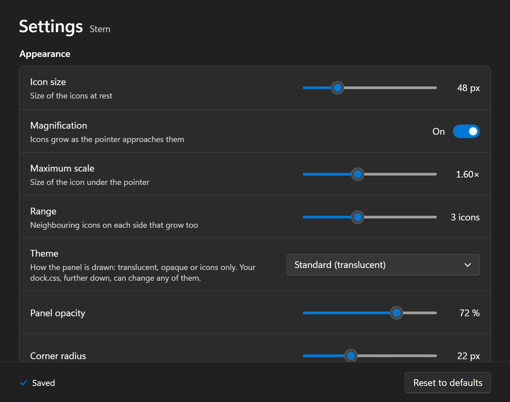

# The settings window

Open the settings window from the tray icon (_Settings…_) or from the dock
(right-click, then _Stem settings…_). Every change applies at once and is
saved at once. There is no _Apply_ button. _Reset to defaults_ at the bottom
of the window shows a confirmation first. Its _Reset_ button restores every
default, removes all pinned apps and shows the hidden apps again.

The settings are stored in one file,
`%APPDATA%\dev.davidcristian.stem\settings.json`. The
[settings reference](../SETTINGS.md) lists every key of that file. The sections
below name the keys behind each part of the window. Stem reads the file when
it starts and writes it again after every change, so quit Stem before you
edit the file by hand. A number outside its range is set to the nearest end
of the range. A file that Stem cannot read is renamed to
`settings.json.broken`, and Stem starts with the defaults. Such a file is
broken JSON, a file written by a newer version of Stem, or a file with a
value of the wrong kind, such as a negative `iconSize` or
`"position": "buttom"`. The [settings reference](../SETTINGS.md) lists which
values those are.

Sizes are in CSS pixels, which Windows display scaling multiplies: at 150 %
scaling, an icon size of 48 is drawn 72 physical pixels wide.

The settings window, shown with demo data

## Appearance

_Icon size_ is `iconSize`. _Magnification_, _Maximum scale_ and _Range_ are
the [`magnification`](../SETTINGS.md#magnification) keys. _Theme_, _Panel
opacity_, _Corner radius_, _Backdrop_, _Tooltips_ and _Bounce on launch_ are
the [`appearance`](../SETTINGS.md#appearance) keys. _Colour mode_ is `theme`.
_Your styles (dock.css)_ is not a setting but a file of your own.

- _Icon size_ is the largest size the dock draws its icons at. Sometimes the
  dock, with room for _Magnification_, would be longer than its edge of the
  screen (many items on a side edge, or a small monitor). The dock then
  draws the icons smaller until it fits, down to 16 pixels. It goes back to
  your size once there is room.
- _Magnification_ makes icons grow as the pointer approaches them. The icon
  right under the pointer grows to _Maximum scale_, and _Range_ is the
  number of neighbouring icons on each side that grow too.
- _Backdrop_ offers _Blur (built in)_ (`css`). _Acrylic (not yet available)_
  and _Mica (not yet available)_ are greyed out. With `acrylic` or `mica`
  written into the file, Stem draws an experimental native material behind
  the primary dock's panel on Windows 11 22H2 or later. Secondary docks,
  older Windows builds and a contrast theme keep the blur. Saving from the
  settings window keeps the value.
- _Bounce on launch_ bounces the icon of an app you started from the dock
  while the app is starting.
- _Theme_ is how the panel is drawn: _Standard (translucent)_, _Solid
  (opaque)_ or _Minimal (icons only)_. See [Themes](themes.md). _Panel
  opacity_ applies to _Standard_ only and is greyed out for the other two.
- _Colour mode_ sets the colours of the dock and the settings window. _Use
  Windows setting_ (`system`) uses the Windows app mode (light or dark).
  _Light_ (`light`) and _Dark_ (`dark`) override it.
- _Your styles (dock.css)_ shows where your own stylesheet is and whether the
  dock uses it, with the buttons _Edit dock.css_ and _Reload_. See
  [Themes](themes.md).

In every theme, the dock uses the Windows accent colour. With _Transparency
effects_ off in Windows, the _Standard_ panel is almost opaque. With a
Windows contrast theme on, the dock and the settings window use the contrast
theme's solid colours, in every theme.

## Behaviour

_Clicking the active app minimises it_, _Scrolling over an app_, _Show only
windows on the current desktop_, _Show only windows on the dock's monitor_,
_Running indicators_, _Click through outside the dock_, _Toggle the dock_ and
_Focus the dock_ are the [`behavior`](../SETTINGS.md#behavior) keys. _Auto-hide_
and _Auto-hide delay_ are the [`autoHide`](../SETTINGS.md#autohide) keys.

- _Clicking the active app minimises it_: see
  [Clicking an app](clicking-an-app.md).
- _Scrolling over an app_: _Does nothing_ (the default) or _Cycles its
  windows_. See [Scrolling over an app](scrolling-over-an-app.md).
- _Show only windows on the current desktop_ is on by default. It leaves out
  windows on other virtual desktops. Pinned apps stay on the dock.
- _Show only windows on the dock's monitor_ applies only with a dock on every
  monitor, and is greyed out otherwise. See
  [More than one monitor](multiple-monitors.md).
- _Running indicators_ draws the dots that show an app's open windows. See
  [Clicking an app](clicking-an-app.md).
- _Click through outside the dock_ is on by default. Clicks beside and above
  the panel then reach the desktop and the windows behind it. With it off,
  the whole dock window takes clicks, and that window spans the whole edge
  of the screen. The switch is there for diagnosing problems, not as a
  preference. It is also a check item in the tray icon's menu.
- _Toggle the dock_: see
  [The toggle shortcut](keyboard-shortcuts.md#the-toggle-shortcut).
- _Focus the dock_: see
  [The focus shortcut](keyboard-shortcuts.md#the-focus-shortcut).
- _Auto-hide_ and its delay: see [Auto-hide](auto-hide.md). The delay counts
  from the moment the pointer leaves the dock, or a window starts to cover
  it.

## Items

_Start_, _Task View_, _Show Desktop_, _Quick Settings_, _Notification Center_,
_Volume_, _Battery_, _Clock_, _Recycle Bin_ and _Separators_ are the
[`items`](../SETTINGS.md#items) keys. The first nine are the fixed items (see
[Fixed items](fixed-items.md)). _Separators_ draws thin lines between the fixed
items, the pinned apps and the other running apps. _Start_, _Recycle Bin_
and _Separators_ are on by default. The others are off.

## Pinned apps

The _Pinned apps_ section of the window lists the pinned apps.
[The Pinned apps section](pinned-apps.md#the-pinned-apps-section) describes
what it shows and the `pinned` array behind it.

## Hidden apps

The _Hidden apps_ section of the window lists the apps you hid from the dock.
[The Hidden apps section](hidden-apps.md#the-hidden-apps-section) describes
what it shows and the `hiddenApps` array behind it.

## Position & monitors

_Position_ is `position` and _Monitors_ is `monitors`, both at the
[top level](../SETTINGS.md#top-level) of the file.

- _Position_ is the edge of the screen the dock is on: _Bottom_ (`bottom`,
  the default), _Left_ (`left`), _Right_ (`right`) or _Top_ (`top`). A change
  applies at once. On the left and the right, the dock is a column centred
  on the edge, with Start at the top and the Recycle Bin at the bottom. Its
  icons grow towards the middle of the screen, and the title pills appear
  beside them. On the top, the dock is a row centred below the screen's top
  edge. On every edge, the dots are between the icons and the screen edge.
- _Monitors_: _Primary monitor only_ (`primary`) gives one dock, on the
  primary monitor. _All monitors_ (`all`) gives one dock on every monitor.
  See [More than one monitor](multiple-monitors.md).

## System

_Start Stem when you sign in_, _Hide the Windows taskbar_, _Reserve screen
space_ and _Write a log file_ are the [`system`](../SETTINGS.md#system) keys.

- _Start Stem when you sign in_: see
  [Starting with Windows](starting-with-windows.md).
- _Hide the Windows taskbar_ turns on Windows' own taskbar auto-hide while
  Stem runs, and puts your setting back when Stem quits. See
  [Hiding the Windows taskbar](hiding-the-windows-taskbar.md).
- _Reserve screen space_ takes a band at the dock's edge out of the work
  area (the part of the screen that maximised windows fill), as the stock
  taskbar does. Maximised windows then stop short of the dock instead of
  going under it. The band is as thick as the resting panel plus its margin
  to the screen edge. Magnified icons still reach past the band, over other
  windows. The setting works only while _Auto-hide_ is off, because a dock
  that hides itself reserves nothing. The switch is greyed out while
  auto-hide is on. A change applies at once. A dock hidden from the tray or
  with the toggle shortcut gives its band back until it is shown again.
- _Write a log file_ is read when Stem starts, so a change applies after a
  restart (the tray icon's _Restart_ does one). See
  [The log file](crashes-and-logs.md#the-log-file).

The file also has a [`version`](../SETTINGS.md#top-level) field. Stem sets it,
so leave it as it is.

## About

The last section of the window is not a setting. It shows Stem's version,
the path of the settings file and the path of the log file. Each path has an
_Open folder_ button, which opens its folder in File Explorer. While file
logging is off, the log row says _File logging is off_ and its button is
disabled.
